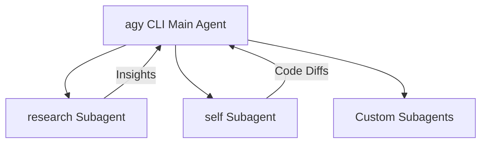

## Primeiros passos {.cols-3}

### Início rápido {.row-span-2}

```bash
# Launch interactive session in current repository
$ agy

# Resume most recent session
$ agy -c
$ agy --continue

# Resume a specific session by conversation ID
$ agy --conversation <conversation-id>

# Run non-interactive prompt and print output
$ agy -p "explain the architecture of this repo"
$ agy --print "fix lint errors across src/"

# Run prompt and continue interactively
$ agy -i "refactor auth middleware"
$ agy --prompt-interactive "add unit tests"

# Pipe stdin directly to agy
$ git diff | agy -p "write a git commit message"
$ cat logs.txt | agy -p "identify crash trace"

# Multi-directory workspace
$ agy --add-dir ../backend --add-dir ../frontend
```

### Autenticação

| Método | Descrição |
| --- | --- |
| **Conta Google** | Execute `agy` e siga os prompts de login no navegador na primeira execução |
| **Vertex AI (ADC)** | `gcloud auth application-default login` |
| **Conta de serviço** | Defina `GOOGLE_APPLICATION_CREDENTIALS=/path/to/sa.json` |
| **Seleção de projeto** | `agy --project <project-id>` ou `GOOGLE_CLOUD_PROJECT` |

### Métodos de instalação

```bash
# Verify installation
$ agy --help

# Configure environment PATH and shell settings
$ agy install

# Update CLI to latest release
$ agy update

# View release notes & changelog
$ agy changelog
```

### Modos de execução

| Modo | Flag de comando | Descrição |
| --- | --- | --- |
| **Padrão** | *(padrão)* | Pede confirmação antes de modificar arquivos ou executar comandos |
| **Aceitar edições** | `--mode accept-edits` | Aplica edições e grava arquivos automaticamente, sem pedir confirmação |
| **Modo Plan** | `--mode plan` | Formula planos de implementação passo a passo antes de mexer no código |
| **Sandbox** | `--sandbox` | Restringe a execução de shell a um sandbox de terminal isolado |
| **Sem restrições** | `--dangerously-skip-permissions` | Aprova automaticamente todos os prompts de permissão de ferramentas |

### Conceitos-chave

- **Loop agêntico**: inspeciona arquivos dinamicamente, executa comandos shell, visualiza diffs e se autocorrige com base nos resultados das ferramentas.
- **Divulgação progressiva**: skills e regras contextuais são carregadas sob demanda, em vez de poluir o contexto de tokens.
- **Tarefas assíncronas**: comandos em segundo plano e execuções multiagente rodam em paralelo sem bloquear os turnos.

---

## Opções da CLI {.cols-2}

### Flags principais {.row-span-2}

| Flag | Curta | Descrição |
| --- | --- | --- |
| `--print <prompt>` | `-p` | Executa o prompt de forma não interativa e imprime a resposta |
| `--prompt-interactive <prompt>` | `-i` | Executa o prompt inicial e permanece interativo |
| `--continue` | `-c` | Retoma a conversa mais recente |
| `--conversation <id>` | | Retoma uma conversa específica por ID |
| `--model <model>` | | Especifica o modelo da sessão |
| `--effort <level>` | | Define o esforço de raciocínio (`low`, `medium`, `high`) |
| `--mode <mode>` | | Modo do agente (`accept-edits`, `plan`) |
| `--sandbox` | | Ativa as restrições de sandbox do terminal |
| `--dangerously-skip-permissions` | | Aprova automaticamente todas as permissões de ferramentas |
| `--add-dir <path>` | | Adiciona um diretório ao workspace (repetível) |
| `--project <id>` | | ID do projeto Google Cloud / Vertex |
| `--new-project` | | Cria um novo projeto para esta sessão |
| `--output-format <format>` | | Formato de saída (`text`, `json`, `stream-json`) |
| `--input-format <format>` | | Formato de entrada (`text`, `stream-json`) |
| `--json-schema <schema>` | | Impõe um JSON schema estruturado para as saídas |
| `--print-timeout <duration>` | | Limite de timeout para o modo print (padrão `0s`) |
| `--log-file <path>` | | Sobrescreve o path do arquivo de log da CLI |
| `--remote-control` | | Conecta ao daemon de controle remoto em segundo plano |
| `--disable-slash-commands` | | Desativa a expansão de slash commands no modo print |

### Subcomandos

```bash
# Manage MCP servers
$ agy mcp [list|add|remove|enable|disable]

# Manage plugins
$ agy plugin [list|install|uninstall|enable|disable|import|validate]

# List supported AI models
$ agy models

# List available agents
$ agy agents

# Manage remote control background daemon
$ agy remote-control [start|status|stop]

# Serve microphone input to a CLI on another host
$ agy mic-serve

# Update agy CLI
$ agy update
```

### Formatos headless e CI/CD

```bash
# Plain text output
$ agy -p "check repo for vulnerabilities" --output-format text

# JSON output for tooling pipelines
$ agy -p "extract exported API endpoints" --output-format json

# NDJSON streaming for real-time consumers
$ agy -p "generate OpenAPI spec" --output-format stream-json

# Enforce structured output via JSON Schema
$ agy -p "list todos" --json-schema schema.json --output-format json
```

---

## Seleção de modelo e raciocínio {.cols-2}

### Modelos e esforço de raciocínio {.row-span-2}

```bash
# Check all available models
$ agy models

# Run with Gemini 3.8 Flash with high reasoning (fast & deep)
$ agy --model gemini-3.8-flash-high

# Run with Gemini 3.1 Pro for complex architectures
$ agy --model gemini-3.1-pro-high

# Run with Claude Sonnet 4.6 (Thinking)
$ agy --model claude-sonnet-4-6

# Specify reasoning effort level
$ agy --effort high
$ agy --effort medium
$ agy --effort low
```

### Referência de modelos

| Identificador do modelo | Nome de exibição | Uso recomendado |
| --- | --- | --- |
| `gemini-3.8-flash-high` | Gemini 3.8 Flash (High) | Codificação diária, turnos rápidos do agente, padrão |
| `gemini-3.8-flash-medium` | Gemini 3.8 Flash (Medium) | Equilíbrio entre velocidade e tokens de raciocínio |
| `gemini-3.8-flash-low` | Gemini 3.8 Flash (Low) | Menor latência, consultas leves |
| `gemini-3.7-flash-high` | Gemini 3.7 Flash (High) | Raciocínio alto da geração anterior |
| `gemini-3.1-pro-high` | Gemini 3.1 Pro (High) | Refatorações massivas, design entre repositórios |
| `claude-sonnet-4-6` | Claude Sonnet 4.6 | Assistente de codificação com thinking habilitado |
| `claude-opus-4-6-thinking` | Claude Opus 4.6 | Raciocínio profundo e complexo em várias etapas |
| `gpt-oss-120b-medium` | GPT-OSS 120B | Camada de raciocínio com pesos abertos |

---

## Slash commands interativos {.cols-3}

### Slash commands `/` {.row-span-3}

| Slash command | Finalidade |
| --- | --- |
| `/help` | Mostra os slash commands e keybindings disponíveis |
| `/plan` | Formula um design e um plano em várias etapas antes da execução |
| `/goal` | Modo autônomo: executa até o objetivo ser concluído |
| `/boost` | Raciocínio profundo, exploração por vários ângulos, verificações rigorosas |
| `/browser` | Automação web, inspeção de páginas e testes ao vivo |
| `/grill-me` | Entrevista interativa para fechar decisões de design |
| `/schedule` | Define um timer único ou um agendamento cron recorrente |
| `/teamwork-preview` | Colaboração multiagente autônoma |
| `/learn` | Persiste preferências e aprendizados do desenvolvedor |
| `/exit` | Sai da sessão da CLI |
| `/quit` | Alias para `/exit` |

### Modos Goal e Boost

```bash
# Inside interactive agy:
> /goal Implement end-to-end tests for billing API and verify they pass

# Boost mode for mission-critical changes:
> /boost Review security implications of session token rotation
```

### Entrevistas interativas

```bash
# Challenge your assumptions before writing code
> /grill-me I want to migrate our database from MongoDB to Postgres
```

---

## Atalhos de teclado {.cols-3}

### Controles gerais {.row-span-2}

| Atalho | Ação |
| --- | --- |
| `Ctrl+D Ctrl+D` | Sai da sessão da CLI do agy |
| `Ctrl+C` | Cancela o turno do agente em execução ou a resposta em streaming |
| `Enter` | Envia o prompt / a mensagem |
| `Shift+Enter` | Insere uma nova linha na entrada multilinha |
| `Alt+Enter` | Insere uma nova linha na entrada multilinha |

### Navegação na entrada

| Atalho | Ação |
| --- | --- |
| `Up` / `Down` | Navega pelo histórico de prompts |
| `Ctrl+A` | Move o cursor para o início da linha |
| `Ctrl+E` | Move o cursor para o fim da linha |
| `Ctrl+U` | Apaga do cursor até o início da linha |
| `Ctrl+K` | Apaga do cursor até o fim da linha |
| `Ctrl+L` | Limpa a tela do terminal |

### Controle do agente

| Ação | Como |
| --- | --- |
| **Aceitar edição** | Pressione `Enter` ou clique em Approve no prompt da ferramenta |
| **Rejeitar edição** | Pressione `Esc` ou digite um feedback |
| **Interromper** | `Ctrl+C` interrompe a chamada da ferramenta imediatamente |

---

## Subagentes e delegação {.cols-2}

### Arquitetura de subagentes {.row-span-2}

O Antigravity CLI pode invocar subagentes especializados que executam em paralelo, com seus próprios contextos e workspaces:



- **Contexto isolado**: os subagentes mantêm a janela de contexto do turno principal limpa e concisa.
- **Trabalho em paralelo**: subagentes em segundo plano relatam resultados automaticamente, sem polling.
- **Modos de workspace**:
  - `inherit`: compartilha o workspace do projeto atual.
  - `branch`: cria um branch isolado em um git worktree.
  - `share`: usa o cache compartilhado do repositório sem copiar o armazenamento.

### Tipos de subagente integrados

| Subagente | Escopo | Finalidade |
| --- | --- | --- |
| `research` | Somente leitura | Busca na web, exploração da base de código, análise de documentação |
| `self` | Todas as ferramentas | Herda as ferramentas do pai para executar edições paralelas em branches |
| `custom` | Configurável | Definido dinamicamente via `define_subagent` |

---

## Servidores MCP (Model Context Protocol) {.cols-2}

### Gerenciar servidores MCP {.row-span-2}

O Antigravity integra servidores MCP nativamente para conectar seu agente a bancos de dados externos, APIs e devtools:

```bash
# List configured MCP servers
$ agy mcp list

# Add local process (stdio) MCP server
$ agy mcp add postgres npx -y @modelcontextprotocol/server-postgres "postgresql://localhost/db"

# Add HTTP / SSE MCP server
$ agy mcp add weather https://api.weather-mcp.internal/sse

# Disable an MCP server temporarily
$ agy mcp disable postgres

# Re-enable an MCP server
$ agy mcp enable postgres

# Remove an MCP server
$ agy mcp remove postgres
```

### Configuração e carregamento de ferramentas

Os servidores ficam em `~/.gemini/antigravity-cli/mcp/<serverName>/`:

- **Ferramentas eager**: carregadas automaticamente no registro nativo de ferramentas do agente.
- **Ferramentas lazy**: registradas sob demanda via schemas (`<toolName>.json`) para economizar tokens do prompt.
- **Instruções**: o arquivo opcional `instructions.md` orienta o agente sobre quando e como chamar ferramentas.

---

## Personalização: regras e skills {.cols-3}

### Regras hierárquicas {.row-span-2}

As regras orientam padrões de código e instruções automaticamente:

- **Raiz do projeto**: `GEMINI.md`, `AGENTS.md`
- **Regras com escopo**: `.agents/rules/*.md` ou `.gemini/rules/`
- **Descoberta hierárquica**: percorre do arquivo ativo até a raiz do git.

```markdown
<!-- GEMINI.md example -->
# Project Guidelines
- Always use TypeScript strict mode.
- Write tests with Vitest in tests/ directory.
```

### Skills de agente

Skills ensinam workflows e procedimentos reutilizáveis:

- Ficam em `.agents/skills/<name>/SKILL.md` ou `~/.gemini/config/skills/`.
- Carregadas dinamicamente via **Divulgação progressiva** (ativadas apenas quando relevantes).

```yaml
---
name: deploy-preview
description: Deploy branch to preview environment and run smoke tests
---
# Runbook steps here...
```

### Ordem de precedência

1. Projeto do workspace (`.agents/`)
2. Declarado no workspace (`skills.json`, `plugins.json`)
3. Configuração global do usuário (`~/.gemini/config/`)
4. Aplicações e skills integradas
5. Configuração global declarada

---

## Plugins e extensões {.cols-2}

### Gerenciar plugins {.row-span-2}

Plugins empacotam skills, regras, hooks e servidores MCP em unidades instaláveis:

```bash
# List all installed plugins
$ agy plugin list

# Install from registry or marketplace
$ agy plugin install security-auditor@marketplace

# Install local plugin package
$ agy plugin install ./my-plugin

# Import plugins from Claude or Gemini configs
$ agy plugin import gemini
$ agy plugin import claude

# Validate plugin manifest and schema
$ agy plugin validate ./my-plugin

# Enable / Disable a plugin
$ agy plugin enable security-auditor
$ agy plugin disable security-auditor

# Uninstall plugin
$ agy plugin uninstall security-auditor
```

### Estrutura de plugin

```
my-plugin/
├── plugin.json       # Manifest (name, version, entrypoints)
├── skills/           # Custom agent skills
│   └── audit/SKILL.md
├── rules/            # Custom rules and guidelines
│   └── security.md
└── mcp_config.json   # Bundled MCP server definitions
```

---

## Configuração e armazenamento do brain {.cols-2}

### Locais de configuração {.row-span-2}

| Escopo | Path | Finalidade |
| --- | --- | --- |
| **Configurações da CLI** | `~/.gemini/antigravity-cli/settings.json` | Preferências globais da CLI, modelo padrão, raciocínio |
| **Configuração global** | `~/.gemini/config/` | Skills, regras e plugins de todo o usuário |
| **Configuração do workspace** | `.agents/` ou `.gemini/` | Regras e configurações de agente com escopo do projeto |
| **Sessões e brain** | `~/.gemini/antigravity-cli/brain/<session-id>/` | Transcrições, tarefas e artefatos gerados |

### Exemplo de `settings.json`

```json
{
  "model": "gemini-3.8-flash-high",
  "effort": "high",
  "mode": "accept-edits",
  "telemetry": false
}
```

### Transcrições e artefatos

- As transcrições ficam em `brain/<id>/.system_generated/logs/transcript.jsonl`.
- Artefatos Markdown e relatórios de diff ficam em `brain/<id>/`.

---

## Veja também {.cols-1}

- [Documentação oficial do Antigravity](https://antigravity.google/docs) _(antigravity.google)_
- [Guia de referência da CLI](https://antigravity.google/docs/cli/reference) _(antigravity.google)_
- [Recursos da CLI e subagentes](https://antigravity.google/docs/cli/features) _(antigravity.google)_
- [Documentação de skills](https://antigravity.google/docs/skills) _(antigravity.google)_
- [Guia de regras e diretrizes](https://antigravity.google/docs/rules-workflows) _(antigravity.google)_
- [Model Context Protocol (MCP)](https://antigravity.google/docs/mcp) _(antigravity.google)_
- [Antigravity Python SDK](https://github.com/google-antigravity/antigravity-sdk-python) _(github.com)_
